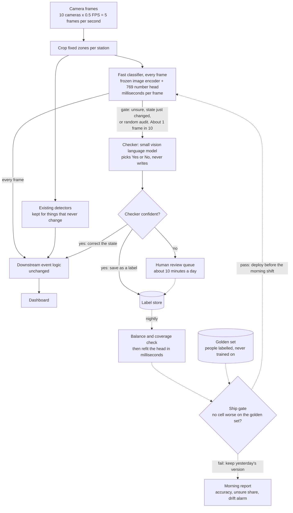
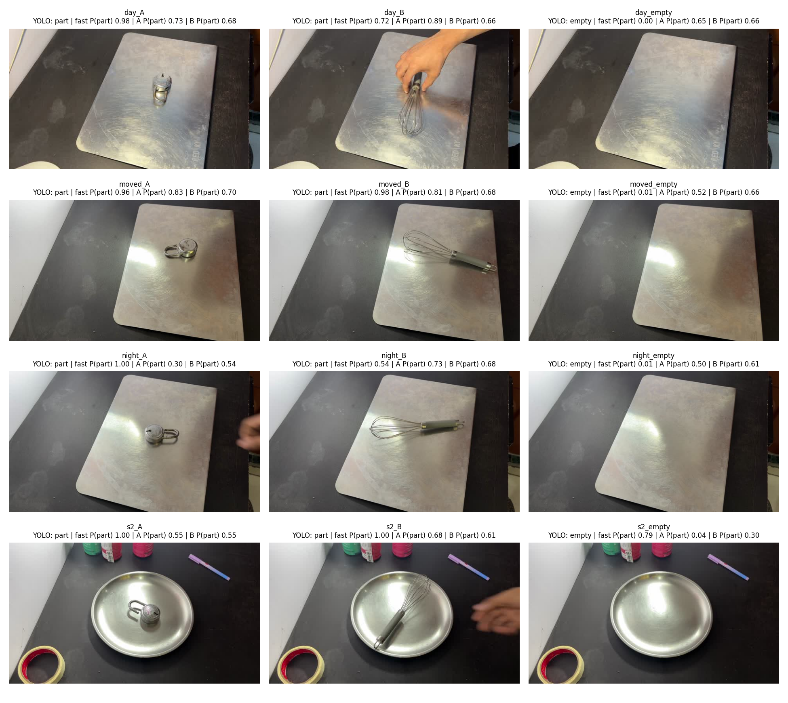
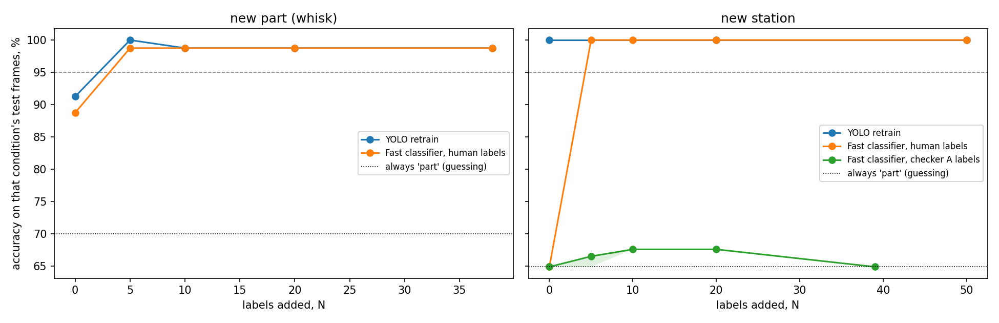
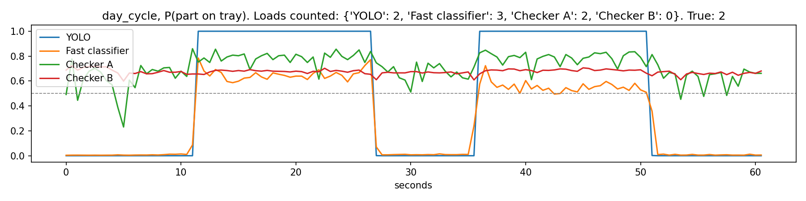

# Can a vision language model watch ten factory cameras on one edge box?

A three day test, built on a phone, a steel tray and a cloud GPU.

By Chander Maurya Kumbkarni · September 2026

> [!NOTE]
> **Where this came from.** This started as a take-home brief in a final round interview for an operations role. I am not a machine learning engineer. The company and its product are not named, and nothing here is their data: every frame was filmed on my phone at home. The design, the test and the write-up are mine.

## In this repository

| Path | What it is |
|---|---|
| `notebooks/edge_vision_adaptation_test.ipynb` | the experiment. Runs on a free Colab T4 in about 30 minutes |
| `notebooks/demo_video.ipynb` | makes the one minute demo video from the clips and the saved predictions. CPU only |
| `results/run4/` | the numbers behind every table here: `results.json`, per frame predictions, charts |
| `media/edge_vision_demo.mp4` | the demo video: every approach's verdict on every frame |
| `scripts/mac_vlm_speed.py` | times a local VLM through Ollama, deciding against writing |

The 13 phone clips (about 260 MB) are not in git. They are attached to the `clips-v1` release, and the notebooks download them from there. The notebooks are committed without outputs. The outputs of the run reported here are in `results/run4/`.

Code is under the MIT licence. The clips, frames and video are my own footage.

## 1. The short version

- **The question:** factory camera systems often run a stack of fine-tuned detectors. They are accurate, but every new part, light or layout means new images, new labels and a retrain. Could a vision language model (VLM) fix that, on one edge box, with no image leaving the site?
- **The constraint:** 10 cameras at 0.5 frames per second on a single Jetson AGX Orin 32GB class box. That is 5 frames per second, so about 200 ms of GPU time per frame for everything.
- **The answer:** yes, if the VLM decides instead of writing. Same model, same frames: 76 ms to pick Yes or No, 498 ms to write a 60 token JSON answer.
- **The design:** a tiny classifier answers every frame. The VLM only sees the frames the classifier is unsure about, and its confident answers become training labels. The classifier refits every night in milliseconds. Automatic checks decide what goes live.
- **The honest part:** the existing style of detector was as accurate or better everywhere in my test. The win is the cost of adapting, not accuracy. And the most useful thing the test did was reject my own model.

## 2. Five ideas the design rests on

| # | Idea | In one line | What the test showed |
|---|---|---|---|
| 1 | Decide, don't write | the VLM ticks a box in one pass instead of writing an answer word by word | 76 ms to decide against 498 ms to write, same model, same frames |
| 2 | Ask about the machine, not the product | "is the fixture empty?" works for any part. "Is part X there?" needs data about part X | a classifier that had never seen the new part still caught it 98% of the time in daylight |
| 3 | Specialist on every frame, generalist when unsure | the cheap model runs always, the expensive one checks the hard frames | the checker would have seen 4.8% of frames in the test |
| 4 | Learn by refitting a tiny layer | the big image model is frozen. Only 769 numbers change | refit in 4 to 10 ms, against a 26 second GPU retrain |
| 5 | Automatic checks, not meetings | a balance check before training, a ship gate before going live, a drift alarm every day | the ship gate blocked my own classifier |

## 3. The design

Solid lines happen on every frame. Dotted lines happen once a day.

**The parts**

- **Fast classifier:** a frozen image encoder (SigLIP 2) turns each frame into 768 numbers, a fingerprint of what is in it. A logistic regression (768 weights and one offset, so 769 numbers) turns the fingerprint into a probability that a part is on the fixture. Only the 769 numbers ever learn, which is why learning takes milliseconds.
- **The gate:** a frame goes to the checker only if the fast classifier is unsure (probability between 0.2 and 0.8), its answer just changed, or a small random audit picks it.
- **Checker:** a small VLM asked a yes/no question. It reads the frame once and I read its probability of "Yes" straight from that pass. Nothing is written, so it cannot ramble, break a format or invent an answer.
- **Label store and nightly refit:** confident checker answers and a few minutes of human clicks become labels. Every night the tiny head refits on them.
- **The checks:** a balance check (no training on lopsided data), a coverage check (every part and every light represented), a ship gate (a new version goes live only if no cell of a fixed, people-labelled test set gets worse) and a drift alarm (the share of unsure frames jumps).

**Augment, don't replace.** The existing detectors keep the things that never change. The new layer handles what does.

## 4. The test

**Setup**

- A phone on a stand as the CCTV camera, looking down at about 45 degrees. A flat steel tray as the fixture. Part A (the old part) was a steel padlock. Part B (the new part) was a steel whisk, picked because thin wires throw glare.
- 13 clips, about 30 seconds each. One change per group of clips, so every drop in accuracy has one cause.
- Frames pulled at 2 per second: 520 frames, 341 allowed to train, 179 held back as the test.
- Each clip is split by time: the first 70% may train, the last 30% is the test. Neighbouring frames are near twins, so a random split would leak answers.
- All daylight frames of the new part are test only. Nobody trains on the new part in daylight.
- Every choice (the classifier's one setting, the wording of the question) was made on training frames. Test frames were never used to choose anything.

**Four approaches**

| | YOLO stand-in | Fast classifier | Checker A | Checker B |
|---|---|---|---|---|
| What it is | `yolo11n-cls`, a small YOLO classifier | SigLIP 2 (frozen) + logistic regression | Qwen3.5-0.8B, a small VLM | Intern-Decision-0.8B, a vision decision model |
| Plays the role of | today's route: retrain for every change | the proposed specialist | the generalist, plain version | the generalist, purpose built |
| Learns by | retraining all its weights on a GPU | refitting 769 numbers | never trained | never trained |

**Four changes a real site meets:** a new product, a lighting change, a bumped camera, a new station layout.

**Two numbers for each:** accuracy right after the change with nothing retrained, and the cheapest way back to 95%.

## 5. Results

### 5.1 Speed: deciding fits, writing does not

Timed on a cloud T4 GPU. The edge box column is an estimate (T4 time x 2.5, from the published spec ratios), not a measurement.

| Approach | T4, ms per frame | Estimated share of the edge GPU at 5 frames per second |
|---|---|---|
| YOLO classifier | 5.1 | 6% |
| Fast classifier | 6.7 | 8% |
| Checker A decides, 1 question | 76 | 95% |
| Checker A writes a 60 token JSON | 498 | **623%: does not fit** |
| Checker B decides, 1 question | 164 | 205% |
| Checker B decides, 6 questions in one pass | 239 | 299% |
| Fast classifier + checker B on gated frames only (4.8%) | | **about 22%** |
| The same at the design rate of 1 frame in 10 | | about 38% |

- Deciding is 6.6 times cheaper than writing.
- Checker B answers 6 questions for about 1.5 times the cost of 1.
- The 4.8% gate needs a caveat: only 2 of 105 test frames were actually flagged. The rest is a 3% random audit I set myself, and these were still clips. A live line would send more, which is why I also quote 38%.
- On my laptop (M1 MacBook Air, 8GB, Ollama) the same pattern held: 0.47 seconds to decide against 1.66 seconds to write.

### 5.2 Adapting to change

Accuracy on "is there a part on the tray?", right after the change, then what it took to recover.

| Change | YOLO stand-in | Fast classifier | Checker A | Checker B | "Always say part" |
|---|---|---|---|---|---|
| New product | 91% → 100%: 5 labels, 26 s GPU retrain | 89% → 99%: 5 labels, 7 ms refit | 79% | 71% | 70% |
| Lighting, lamp to daylight | 98% | 100% | 82% | 82% | 82% |
| Lighting, daylight to lamp | 100% | 100% | 68% | 56% | 52% |
| Camera moved | 100% | 100% | 87% | 68% | 68% |
| New layout | 100%, no retrain needed | 65% → 100%: 5 labels, 4 ms refit | 95% | 100% | 65% |

- **Labels were a tie.** Both routes got back with 5 labels. The difference is the cost of the update: a 7 millisecond refit on a CPU against a 26 second GPU retrain here. On a real detector the retrain route also means drawing boxes.
- **The last column matters.** Most test frames have a part on the tray, so a model that answers "part" without looking scores 52 to 82%. On the steel tray, checker B was no better than that.

### 5.3 The ship gate rejected my own model

| Cell | YOLO stand-in | Fast classifier (never saw the new part) | Checker A | Checker B |
|---|---|---|---|---|
| Day, old part | 100 | 100 | 100 | 100 |
| Day, new part | 98 | 98 | 98 | 100 |
| Day, empty | 100 | 100 | 8 | 0 |
| Lamp, old part | 100 | 100 | 54 | 100 |
| Lamp, new part | 100 | **47** | 80 | 100 |
| Lamp, empty | 100 | 100 | 83 | 8 |
| **Mean** | **99.6** | 90.7 | 70.5 | 68.1 |
| Ship gate | current | do not ship | do not ship | do not ship |

- The fast classifier averaged 90.7% but was a coin flip on one cell: the whisk under lamp light. The gate's rule is "no cell worse", so it did not ship. That is the gate doing its job.
- Both checkers failed on the empty steel tray. Glare on brushed steel reads as "something is there".

### 5.4 The teacher loop: 39 correct labels, one blind spot

At the new station I let checker A label the training frames and kept only its confident answers.

- It was confident on 39 of 92 frames. **All 39 were correct.**
- The classifier trained on those labels alone scored **65%**, exactly what "always say part" scores.
- Why: 30 of the labels were "empty" and 9 were "part", and every one of the 9 was the whisk. The checker was never sure about the padlock. So the student learned "whisk means part" and missed every padlock.
- Five human-confirmed frames took the same classifier to 100%.

**The lesson: confident is not the same as covered.** Labels can all be right and still teach a blind spot. A teacher needs a coverage check, not only a confidence cutoff.

### 5.5 Counting loads: right total, wrong reason

One 60 second clip had the new part placed and removed twice. True answer: 2 loads.

- YOLO stand-in: 2, at the right times.
- Fast classifier: 3. It had never seen the part, hovered near 0.5 and one flicker added a load.
- Checker A: 2, but both of its "loads" were on an empty tray. A correct total by luck.
- Checker B: 0.

**The lesson:** a count can match by accident. Check the timing, not just the total.

## 6. What did not work, and what I do not claim

- **I threw away my first two runs.** The first seconds of each part clip showed an empty tray while I was still placing the part, but those frames carried the clip's "part" label. That noise made one model look broken (52% where the clean run gave 98%). The fix was one rule, decided from the footage and not from the results: drop the first 10 seconds of every clip.
- **The classic failure did not reproduce.** I tried to recreate "train on a new part in one light, fail in another". My lamp against daylight change was too mild, and the retrained model held at 98%.
- **Nothing ran on a Jetson.** Everything ran on a cloud T4 and my laptop. Every edge number is an estimate.
- **The fast classifier does not beat YOLO on accuracy.** YOLO was as good or better everywhere. The edge is the cost of adapting.
- **The small checkers were poor teachers on this tray.** At 0.8B they are not ready to replace anything.
- **The checks print verdicts in a notebook.** They are not yet wired in as hard stops.
- **One camera, one scene, one day.** The accuracy numbers will not transfer to a real machine cell. The method, the checks and the speed ratios should.

## 7. What I would do next with real hardware

1. Measure every tier on the actual edge box. Real numbers replace the estimates.
2. Build a golden set: about 300 frames across part, light and state, labelled blind by two people. It becomes the fixed exam for every future model.
3. Crop each zone before any model sees it. Background clutter and glare hurt the checkers most.
4. Try a larger checker (2B) with a confidence cutoff fitted per site.
5. Run in shadow mode beside the existing detectors for a week, with a daily report of every disagreement.
6. Go only if it is at least as accurate in every cell, a new part can be onboarded with 50 labels or fewer in one shift, and everything fits in half the GPU.

## 8. What I learned

- How a VLM actually spends its time: reading is one pass, writing is one pass per token.
- How to turn a generative model into a classifier by reading answer probabilities instead of text.
- Frozen encoders and linear heads, and why a 769 number refit is cheap.
- Test design: time-based splits, one change per test, a "dumb" baseline beside every number, and no choices made on test data.
- Budgeting an edge GPU from published specs, and saying clearly that it is an estimate.
- That the checks around a model (balance, coverage, ship gate, drift) can matter more than the model.

## 9. How it was built

- **Mine:** the question framing, the design, the test design, the filming, reading every result, discarding the bad runs, and every claim in this write-up.
- **AI-assisted:** I directed Claude Code to write the notebook code from my spec, then checked, corrected and reran it four times.
- **Tools:** Python, Ultralytics YOLO11, SigLIP 2, Qwen3.5, Intern-Decision, ffmpeg, Google Colab (T4), Ollama.

## Sources

1. TypeSafe AI, "Introducing System One Models and Jev"
2. Jared Palmer, Kev repository and model cards
3. Qwen3.5-0.8B model card, Hugging Face
4. Lin et al., "Evaluating Text-to-Visual Generation with Image-to-Text Generation" (VQAScore), ECCV 2024
5. NVIDIA Jetson AGX Orin 32GB module specifications
6. NVIDIA Developer Forum, "Optimizing Qwen3-VL 2B inference for 2 QPS on Orin Nano Super"
7. Radford et al., "Learning Transferable Visual Models From Natural Language Supervision" (CLIP), 2021
8. Ultralytics, YOLO11 and YOLOE documentation
9. InternLM, Intern-Decision model cards
